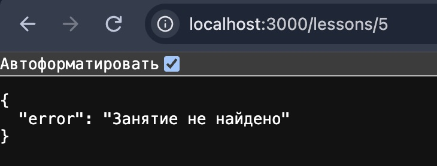
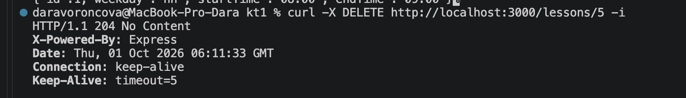
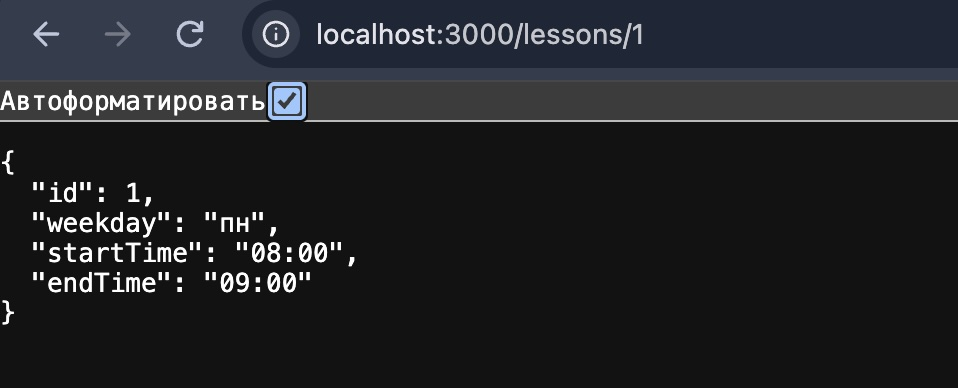
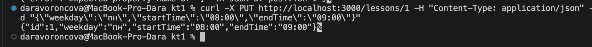
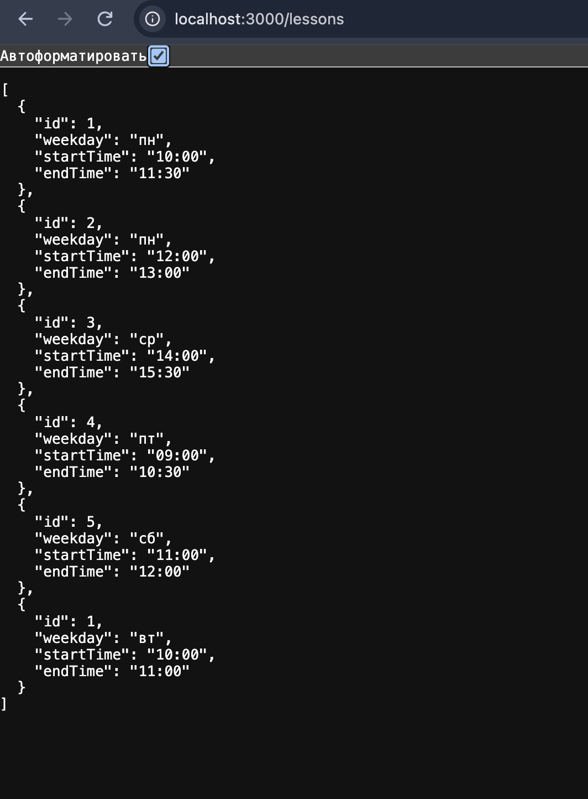
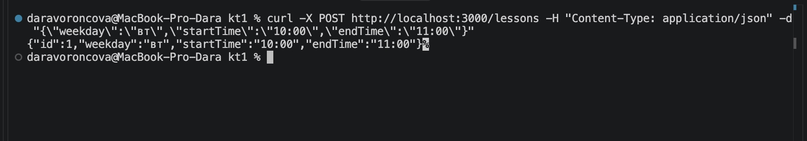
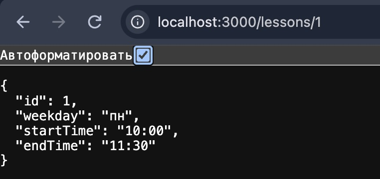
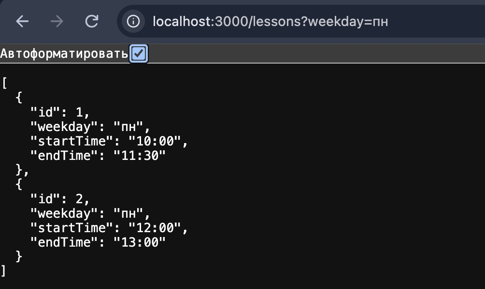
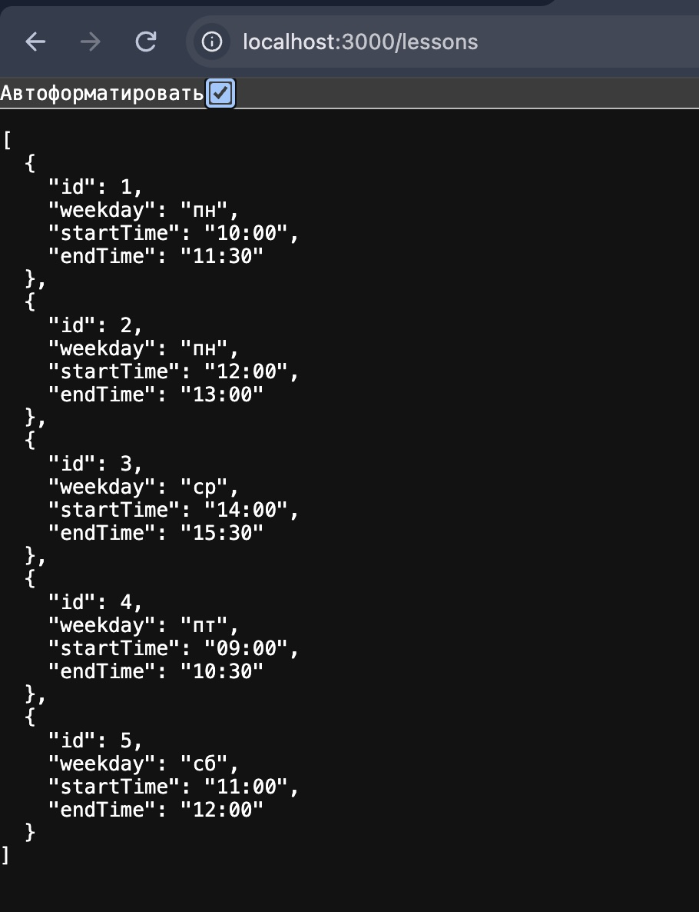

        


# Ответы на вопросы

1. **Почему на `DELETE` возвращается `204`, а не `200`?**  
   Статус `204 No Content` означает, что запрос успешно выполнен, но серверу нечего возвращать в теле ответа. При удалении ресурса возвращать его данные бессмысленно, поэтому `204` - семантически верный стандарт.

2. **Что произойдёт с данными при перезапуске сервера и почему так работает массив в памяти?**  
   Все данные будут потеряны и сбросятся до состояния функции `seed()`. Это происходит потому, что массив хранится в оперативной памяти процесса Node.js, которая полностью очищается при завершении работы процесса.

3. **Зачем нужен вызов `next(err)` и что сломается, если его убрать?**  
   `next(err)` передаёт ошибку в централизованный middleware обработчик ошибок (`errorHandler`). Если его убрать, сервер не отправит клиенту ответ, и HTTP-запрос "зависнет" до тех пор, пока не сработает таймаут соединения.

4. **Как именно в твоём коде реализовано персональное правило варианта? Приведи строки кода.**  
   В файле `src/services/lessonService.js` функция `checkOverlap` проверяет пересечение интервалов:
   ```javascript
   return store.some(l => {
     if (excludeId && l.id === excludeId) return false;
     if (l.weekday !== weekday) return false;
     return startTime < l.endTime && l.startTime < endTime; 
   });


   